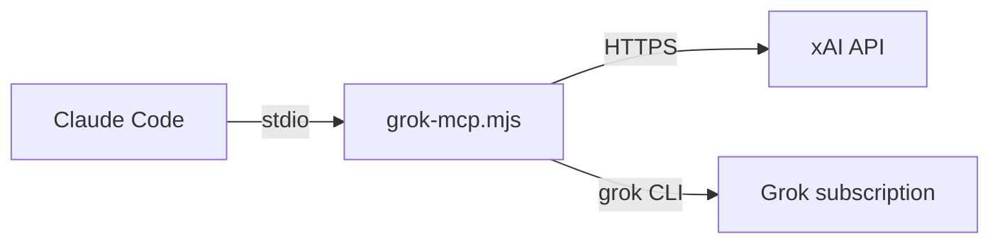
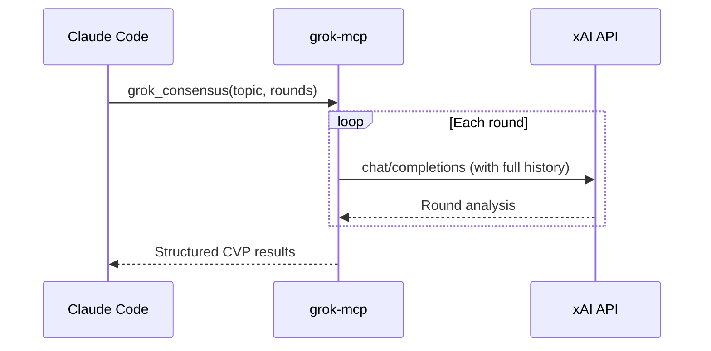

# Grok MCP Server

[](https://www.npmjs.com/package/askgrokmcp)
[](https://nodejs.org)
[](LICENSE)

A [Model Context Protocol](https://modelcontextprotocol.io) (MCP) server that brings Grok into [Claude Code](https://docs.anthropic.com/en/docs/claude-code) as native tools.

Two backends:

| Backend | Meter | Set with |
|---------|--------|----------|
| xAI API | Prepaid API credits | `GROK_BACKEND=api` (default) and `XAI_API_KEY` |
| `grok` CLI | The Grok subscription, including Imagine | `GROK_BACKEND=cli` after `grok login` |

Ask Grok questions, generate images, run multi-round consensus analysis, and explore available models — directly from your terminal. The CLI backend generates images with Imagine. It does not generate video.

---

## Tools

| Tool | Description |
|------|-------------|
| `ask_grok` | Send a prompt to Grok with optional system prompt and sampling parameters |
| `generate_image` | Generate images and save them locally. The API backend calls Aurora. The CLI backend calls Imagine |
| `list_models` | List all xAI models available to your account |
| `grok_consensus` | Run a full Consensus Validation Protocol (CVP) for deep, multi-round analysis |
| `grok_validate` | Run a rigorous multi-round Validation Protocol on any artifact (code, plan, prompt, PR) with scorecard + improved version |

## Built-in Protocols

### Consensus Validation Protocol (CVP)

The `grok_consensus` tool implements a structured, multi-round analysis protocol. Instead of a single prompt-and-response, it runs 3-10 iterative rounds where Grok progressively deepens its analysis — challenging its own assumptions, evaluating evidence strength, and synthesizing a balanced conclusion.

```
> Run CVP on whether large language models can reason
> Ask Grok to validate the claim that sleep deprivation affects decision-making — use 5 rounds
> Consensus check with Grok on the future of nuclear energy
```

The entire protocol executes server-side in a single tool call. Each round builds on the full conversation history for genuine iterative refinement.

**Default:** 3 rounds | **Max:** 10 rounds | [Full protocol documentation](protocols/consensus-validation.md)

### Validation Protocol

The `grok_validate` tool runs a rigorous, multi-round quality gate on any artifact — code, plans, research, prompts, PR descriptions, architectures. Grok produces a scored scorecard (correctness, completeness, innovation/risk, clarity, best practices), identifies critical issues, and returns an improved version ready to copy-paste.

```
> grok_validate with artifact is [paste your plan or code here]
> grok_validate with artifact is [auth module] criteria is security, input validation rubric is security-focused
> grok_validate with artifact is [your plan] reference is [original output] rounds is 6 rubric is strict
```

Supports four rubric presets: `balanced` (default), `strict`, `innovative`, and `security-focused`. An optional `reference` argument enables side-by-side comparison with another model's output.

**Default:** 5 rounds | **Max:** 10 rounds

---

## Prerequisites

- **Node.js** >= 18
- **Claude Code** CLI installed
- **API backend:** an xAI API key from [console.x.ai](https://console.x.ai)
- **CLI backend:** the [grok CLI](https://x.ai/cli) and a completed `grok login`

## Setup

### Option A: Install from npm

```bash
npm install -g askgrokmcp
```

Then register with Claude Code:

```bash
claude mcp add grok -e XAI_API_KEY=your_api_key_here -- grok-mcp
```

### Option B: Clone from source

```bash
git clone https://github.com/marceloceccon/askgrokmcp.git
cd askgrokmcp
npm install
```

Then register with Claude Code:

```bash
claude mcp add grok -e XAI_API_KEY=your_api_key_here -- node /path/to/askgrokmcp/grok-mcp.mjs
```

Replace `/path/to/askgrokmcp` with the actual path where you cloned the repository.

---

Replace `your_api_key_here` with your xAI API key in either option. That's it — the tools are now available in Claude Code and bill API credits.

### Option C: Claude Code plugin (subscription)

Use this when you want text and Imagine images to draw from the Grok subscription instead of API credits.

```bash
git clone https://github.com/marceloceccon/askgrokmcp.git
cd askgrokmcp
npm install
grok login
```

From Claude Code, add this repository as a marketplace and install the plugin:

```text
/plugin marketplace add /path/to/askgrokmcp
/plugin install askgrok@askgrokmcp
```

The plugin starts `bin/plugin-start.mjs` with `GROK_BACKEND=cli`. On a fresh checkout that has no `node_modules`, the launcher runs `npm install` once. Its output stays on stderr.

`XAI_API_KEY` in the environment is removed from the `grok` child process, so a key used by other tools does not switch these calls onto API credits.

`temperature`, `max_tokens`, and `top_p` belong to the API backend. The CLI backend rejects them. Imagine chooses the image model. Pass `model` to `ask_grok` to select a chat model from `list_models`.

## Usage

Once registered, you can use the tools naturally in Claude Code:

### Ask Grok a question

```
> ask grok what the latest news in AI are
```

### Use a system prompt

```
> ask grok to review this code, using a system prompt that says "You are a senior security auditor"
```

### Control sampling parameters

```
> ask grok to generate test data with temperature 0 and max_tokens 500
```

### Use a specific model for one call

```
> ask grok to summarize this document using grok-3
```

### Generate an image

```
> ask grok to generate an image of a sunset over mountains and save it as images/sunset.png
```

### Generate multiple variations

```
> ask grok to generate 4 variations of a logo for a coffee shop and save them as images/logo.png
```

When generating multiple images, files are automatically numbered (e.g., `logo-1.png`, `logo-2.png`, ...).

### Run a consensus analysis

```
> run CVP on the effectiveness of carbon capture technology
> ask grok to validate whether quantum computers will break RSA by 2030 — use 5 rounds
```

### List available models

```
> list the available grok models
> list grok chat models only
> list grok image models
```

## Model Selection

The server uses a three-level priority system for model selection:

| Priority | Mechanism | Scope |
|----------|-----------|-------|
| 1st (highest) | `model` argument in the tool call | Single request |
| 2nd | `GROK_CHAT_MODEL` / `GROK_IMAGE_MODEL` env vars | Server lifetime |
| 3rd (default) | Built-in defaults (see below) | Fallback |

### Built-in defaults

At startup the server probes the xAI `/models` endpoint and selects the best available model:

| Purpose | Frontier (preferred) | Fallback |
|---------|---------------------|----------|
| Chat | `grok-4.3` | `grok-4.3` |
| Image generation | `grok-imagine-image-quality` | `grok-imagine-image-quality` |

If the frontier model is not available on your account, the server automatically falls back to the safe default.

### Change defaults via environment variable

```bash
claude mcp add grok \
  -e XAI_API_KEY=your_api_key_here \
  -e GROK_CHAT_MODEL=grok-3 \
  -e GROK_IMAGE_MODEL=grok-2-image \
  -- grok-mcp
```

### Override per call

Just tell Claude which model to use:

```
> ask grok to explain quantum computing using model grok-3
```

Or use `list_models` first to discover what's available, then pick one.

## File write safety

By default the server only writes images inside the **current working directory** (the directory Claude Code was launched from) and its subdirectories. Any path that resolves outside that directory is rejected with a clear error.

To allow writes to a different location, set the `SAFE_WRITE_BASE_DIR` environment variable to an absolute path:

```bash
export SAFE_WRITE_BASE_DIR=/tmp/my-images
```

Or pass it directly when registering the server:

```bash
claude mcp add grok \
  -e XAI_API_KEY=your_api_key_here \
  -e SAFE_WRITE_BASE_DIR=/tmp/my-images \
  -- grok-mcp
```

> **Note:** Absolute paths that resolve outside the allowed base directory are rejected. Use relative paths (e.g. `images/output.png`) or set `SAFE_WRITE_BASE_DIR` explicitly.

## Configuration

| Variable | Default | Description |
|----------|---------|-------------|
| `GROK_BACKEND` | `api` | `api` calls api.x.ai. `cli` runs the signed-in `grok` CLI |
| `XAI_API_KEY` | *(required for `api`)* | xAI API key. Ignored for `grok` child processes when the backend is `cli` |
| `GROK_BIN` | `grok` | CLI binary used when `GROK_BACKEND=cli` |
| `GROK_CHAT_MODEL` | `grok-4.3` on `api`, CLI default on `cli` | Default model for `ask_grok`, `grok_consensus`, and `grok_validate` |
| `GROK_IMAGE_MODEL` | `grok-imagine-image-quality` | Image model for the API backend. The CLI backend uses Imagine |
| `GROK_CLI_TIMEOUT_MS` | `120000` | Timeout for a text or `grok models` CLI call |
| `GROK_CLI_IMAGE_TIMEOUT_MS` | `180000` | Base timeout for Imagine. Each extra image adds 60 seconds, up to 15 minutes |
| `GROK_CLI_MAX_TURNS` | `2` | Turn cap for text CLI calls |
| `SAFE_WRITE_BASE_DIR` | `process.cwd()` | Base directory for image writes |
| `XAI_REQUEST_TIMEOUT_MS` | `30000` | Timeout per xAI API request in milliseconds |
| `XAI_MAX_RETRIES` | `2` | Number of retries for transient errors (429/5xx/network/timeout) |
| `XAI_RETRY_BASE_DELAY_MS` | `500` | Base delay for exponential retry backoff |
| `LOG_REQUESTS` | `false` | Logs tool and backend request metadata to stderr |
| `LOG_REQUEST_PAYLOADS` | `false` | Includes full request payloads in logs (use carefully) |

## Request logging

Request logging is optional and disabled by default.

Enable metadata-only logs:

```bash
export LOG_REQUESTS=true
```

To also log full request payloads (including prompts), explicitly enable:

```bash
export LOG_REQUESTS=true
export LOG_REQUEST_PAYLOADS=true
```

> **Important:** Logs are written to stderr (not stdout) so MCP protocol communication remains safe.

## Project Structure

```
askgrokmcp/
  grok-mcp.mjs                 Server entry point, config, HTTP client
  bin/plugin-start.mjs         Claude Code plugin launcher (GROK_BACKEND=cli)
  .claude-plugin/plugin.json   Plugin manifest
  .claude-plugin/marketplace.json
  skills/ask-grok/SKILL.md     When to call ask, consensus, validate, or Imagine
  src/tools.js                 Tool definitions and handlers
  src/cli-backend.js           grok CLI subscription backend
  protocols/                   Protocol documentation
    consensus-validation.md
  grok-mcp.test.mjs            API-path test suite
  src/cli-backend.test.mjs     CLI backend test suite
```

## How it works

This server implements the MCP protocol over stdio. When Claude Code starts, it launches the server as a subprocess and communicates with it via JSON-RPC over stdin/stdout. The server translates MCP tool calls into either xAI API requests or a headless `grok` CLI run.



On the CLI backend, text tools run `grok` with tools denied and a one-directory scratch pad, so the coding agent does not edit the project. `generate_image` runs `grok` with only the `image_gen` tool inside a temporary directory, then copies the image through the same path sandbox as the API backend. Multi-round tools send the transcript so far on each turn.

For the `grok_consensus` tool, the server manages a multi-round conversation loop with Grok internally, returning the complete analysis in a single response:



## License

[MIT](LICENSE)
